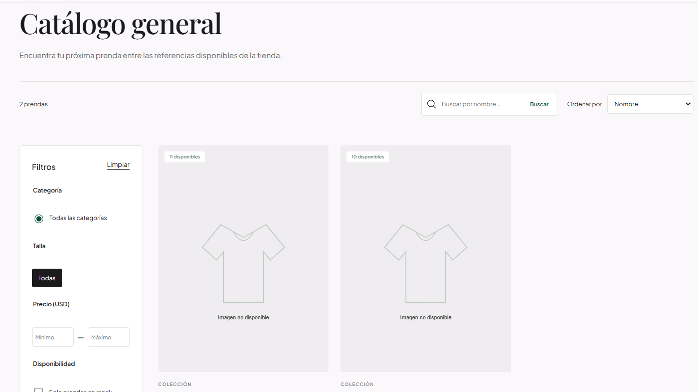
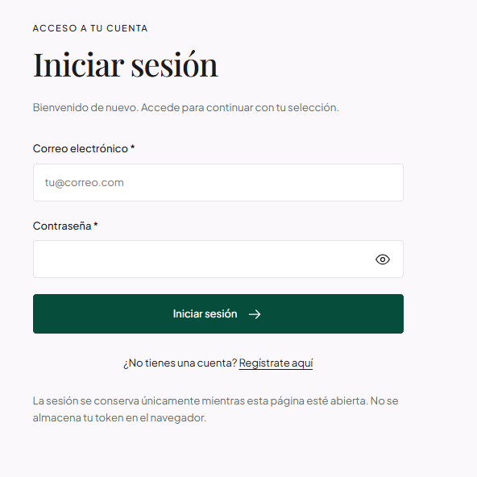
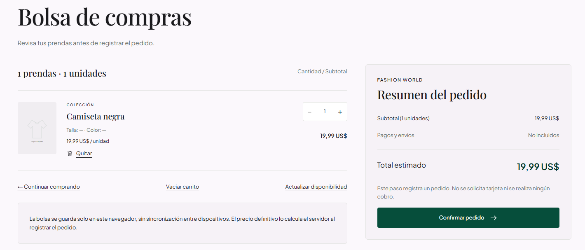

# 🛍️ Fashion World — Tienda web y gestión de pedidos

[](https://spring.io/projects/spring-boot)
[](https://openjdk.org/)
[](https://react.dev/)
[](https://vite.dev/)
[](https://www.postgresql.org/)
[](https://bun.sh/)

**Fashion World** es un proyecto académico de tienda de moda: permite consultar productos, gestionar una bolsa de compra, registrar pedidos y consultar su historial. Los administradores gestionan productos y estados de pedidos mediante una API REST con autenticación JWT.

El frontend React/JSX consume el backend Spring Boot conectado a PostgreSQL. Su interfaz se basa en las diez pantallas del proyecto **Fashion World Tienda Web** de Google Stitch, adaptadas a escritorio y móvil. Crear un pedido no equivale a procesar un pago ni a contratar un envío.

## 🏛️ Arquitectura y stack tecnológico

Arquitectura cliente-servidor: React → peticiones JSON con `fetch` → controladores/servicios Spring → persistencia JPA en PostgreSQL. El backend determina permisos, precios, totales y disponibilidad de stock.

| Capa | Tecnología / versión declarada | Responsabilidad |
| --- | --- | --- |
| Backend | **Spring Boot 4.1.1** | API REST con Spring Web MVC y validación de solicitudes |
| Backend | **Java 21** | Lenguaje y JDK del backend |
| Seguridad | Spring Security + OAuth2 Resource Server, gestionados por Spring Boot | Autorización CLIENTE/ADMIN, JWT HS256 y contraseñas BCrypt |
| Persistencia | Spring Data JPA / Hibernate, gestionados por Spring Boot | Usuarios, productos, pedidos, detalles y transacciones de stock |
| Base de datos | PostgreSQL; versión del servidor no fijada en el proyecto | Persistencia local; driver JDBC gestionado por Spring Boot |
| Construcción | Maven **3.9.16**, Wrapper **3.3.4** | Dependencias y ciclo de compilación/pruebas del backend |
| Frontend | React / React DOM **`^19.2.8`** | Componentes JSX, hooks y contextos de sesión/carrito |
| Frontend | Vite **`^8.3.0`**, plugin React **`^6.1.1`** | Servidor de desarrollo y compilación de la SPA |
| Interfaz | JavaScript, CSS propio y History API nativa | Navegación, estilos responsive y cliente HTTP `fetch`; sin React Router, Axios ni Tailwind |
| Calidad frontend | ESLint **`^10.10.0`** y Bun (sin versión fijada) | Análisis estático, instalación desde lockfile y pruebas del cliente HTTP |
| Pruebas | Spring Test / JUnit y H2, dependencias de test | Pruebas HTTP con base aislada; H2 no es la base de producción |
| Pruebas de navegador | Playwright + Chrome local | E2E sobre backend real H2; Playwright se instala fuera del proyecto |
| Diseño / integración | Google Stitch + MCP + OpenCode | Consulta de diseños y recursos; no es una dependencia del arranque de la tienda |

Versiones contrastadas con [`pom.xml`](./pom.xml), [`package.json`](./fronted-app-ing-web/package.json) y el [Maven Wrapper](./.mvn/wrapper/maven-wrapper.properties). `^` indica un rango declarado, no una versión instalada exacta; el frontend conserva [`bun.lock`](./fronted-app-ing-web/bun.lock). No se atribuyen versiones independientes a las dependencias gestionadas por Spring Boot.

## 🛒 Funcionalidades

### Visitantes y clientes

- Inicio editorial, catálogo, búsqueda y filtros por categoría/talla; combinación, precio y ordenación locales sobre los datos recibidos.
- Detalle de producto con imagen o placeholder, precio, stock y una talla/color por registro.
- Registro como **CLIENTE**, login, consulta de perfil y cierre de sesión local; manejo de expiración y errores de autorización.
- Bolsa con cantidades, eliminación/vaciado y persistencia local de IDs/cantidades, sin guardar credenciales.
- Creación de pedidos con revalidación de precio/stock, confirmación del pedido real e historial/detalle propios.
- Estados de carga, vacío, error HTTP/red y reintento. La bolsa se vacía solo después de una respuesta de creación exitosa.

### Administradores

- Panel de productos, creación, edición y eliminación mediante endpoints reales; formulario de imagen por URL, sin upload.
- Consulta de todos los pedidos y su detalle; edición del estado textual, no vacío y de hasta 50 caracteres.
- Restricción ADMIN tanto en la interfaz como en la API. El registro público no permite crear administradores.
- Borrado rechazado con conflicto si el producto tiene relaciones que impiden eliminarlo. Las métricas del panel se calculan sobre los datos recibidos, no representan cobros.

Cambiar un estado no cobra, despacha ni devuelve stock automáticamente. No se inventan transiciones comerciales. Ante una respuesta de POST perdida, consultar el historial antes de reenviar: la API no ofrece idempotencia.

## 📸 Galería visual de la aplicación

Capturas aportadas de la interfaz de Fashion World. Ilustran las pantallas visibles, no sustituyen las pruebas de API ni acreditan por sí solas un login o pedido completado.

### 1. Inicio — Tu estilo, tu mundo

Cabecera de navegación y portada editorial con accesos para explorar la colección y consultar el contenido editorial.


### 2. Catálogo general

Buscador, ordenación y filtros de categoría, talla, precio y disponibilidad. La captura muestra dos prendas con indicadores de stock y el placeholder de imagen no disponible.



### 3. Inicio de sesión

Formulario de acceso con campos de correo y contraseña, control de visibilidad y enlace al registro. La captura no contiene credenciales introducidas.



### 4. Bolsa de compras

Una prenda en la bolsa, controles de cantidad y eliminación, actualización de disponibilidad y resumen del total estimado. El botón registra un pedido; no realiza cobros ni incluye envíos.



**Imagen de diseño revisada, no publicada:** `04-stich.png` muestra el editor de Google Stitch y su panel de configuración MCP, no la aplicación ejecutándose. Contiene fragmentos visibles de una clave API; no se enlaza hasta que se anonimice esa información. Los HTML/PNG de `docs/stitch` también son referencias de diseño, no evidencia de funcionamiento. Las pruebas se documentan por separado en [`ESTADO_PROYECTO.md`](./ESTADO_PROYECTO.md).

**Nota de entrega:** la regla `screenshots/` de `.gitignore` actualmente excluye esta carpeta. Las cuatro imágenes enlazadas deberán incluirse en la entrega o en el repositorio publicado para que la galería se visualice allí; mantener fuera la captura de configuración mientras contenga información sensible.

## 📋 Requisitos previos

- Java **21** (JDK y `JAVA_HOME`), Bun y PostgreSQL con servicio activo en `localhost:5432`.
- Node.js compatible con Vite 8: **20.19+ dentro de la rama 20, o 22.12+**; el entorno previamente comprobado usó Node 24. También se necesita para los scripts headless.
- PowerShell en Windows para los scripts incluidos y un navegador moderno. Chrome local es necesario solo para E2E.
- Maven se descarga con el wrapper incluido; no se requiere instalación global. Internet para descargar dependencias y, en la interfaz, fuentes/imágenes externas que no estén en los recursos locales.
- Abrir la terminal en la raíz (donde está `pom.xml`). Comprobar herramientas:

```powershell
java -version
node --version
bun --version
.\mvnw.cmd -version
psql --version
```

Si `psql` no está en PATH, añadir el directorio `bin` de tu instalación, por ejemplo `$env:Path = "C:\Program Files\PostgreSQL\18\bin;$env:Path"` (adaptar versión). Iniciar el servicio PostgreSQL desde Servicios de Windows si está detenido. Los puertos 8081 y 5173 deben estar libres antes de arrancar.

## ⚙️ Instalación y configuración

### 1. Obtener el proyecto e instalar dependencias

Obtener las fuentes desde el repositorio autorizado o el paquete académico y abrir PowerShell en la raíz, donde están `pom.xml` y `mvnw.cmd`. No se utiliza el repositorio del compañero para instalar Fashion World ni se presume una URL oficial de clonación.

Desde esa raíz, instalar dependencias frontend si faltan:

```powershell
Set-Location .\fronted-app-ing-web
bun install --frozen-lockfile
Set-Location ..
```

Maven Wrapper descarga las dependencias del backend al compilar o arrancar. No instalar paquetes distintos ni reemplazar el lockfile para seguir esta guía.

### 2. PostgreSQL: base existente o nueva

**Base existente:** conservarla y usar su usuario autorizado. Omitir creación de rol/base e inicialización de tablas. El entorno previamente verificado usa `tienda_usuarios`; nunca ejecutar `update`/`create` sobre sus datos para esta entrega.

**Instalación desde cero:** crear una base académica vacía y separada. Entrar como administrador PostgreSQL (la contraseña se solicita oculta):

```powershell
psql -h localhost -p 5432 -U postgres -d postgres -W
```

Dentro de `psql`, ejecutar una sola vez (los nombres siguientes son ejemplos, no credenciales reales):

```text
CREATE ROLE fashion_world_app LOGIN;
\password fashion_world_app
CREATE DATABASE tienda_usuarios_academica OWNER fashion_world_app;
\q
```

`\password` pide y confirma una contraseña sin mostrarla; no escribirla en SQL ni en archivos. Si rol/base ya existen, no recrearlos ni alterar permisos sin revisar su propietario. El propietario crea las tablas en el esquema `public` de su base nueva; no dar permisos de superusuario a la aplicación.

### 3. Variables de entorno del backend

En **la misma terminal** que ejecutará backend y, si corresponde, restablecimiento ADMIN:

```powershell
# Para una base nueva de la sección anterior. Para la existente, cambiar solo
# el nombre de la base en esta URL a tienda_usuarios y usar su usuario autorizado.
$env:SPRING_DATASOURCE_URL = 'jdbc:postgresql://localhost:5432/tienda_usuarios_academica'
$env:SPRING_DATASOURCE_USERNAME = Read-Host 'Usuario PostgreSQL autorizado'

# Contraseña solo en memoria del proceso; no eco ni literal en el historial.
$secure = Read-Host 'Contraseña PostgreSQL' -AsSecureString
$pointer = [Runtime.InteropServices.Marshal]::SecureStringToBSTR($secure)
try {
    $env:SPRING_DATASOURCE_PASSWORD = [Runtime.InteropServices.Marshal]::PtrToStringBSTR($pointer)
} finally {
    [Runtime.InteropServices.Marshal]::ZeroFreeBSTR($pointer)
    $secure.Dispose()
    Remove-Variable secure,pointer
}
```

`SPRING_DATASOURCE_URL`, `SPRING_DATASOURCE_USERNAME` y `SPRING_DATASOURCE_PASSWORD` son obligatorias; el script falla antes de arrancar si falta una. No hay credencial de respaldo en `application.properties`. Evitar credenciales en la URL JDBC. No usar `setx`, transcripciones, comandos que impriman el entorno ni ficheros `.env` con secretos.

`JWT_SECRET` debe ser Base64 de al menos 32 bytes aleatorios. Si falta, `start-backend.ps1` lo genera criptográficamente solo en el entorno del proceso, sin mostrarlo ni escribirlo. Para la inicialización manual del siguiente paso, generarlo antes:

```powershell
if ([string]::IsNullOrWhiteSpace($env:JWT_SECRET)) {
    $bytes = New-Object byte[] 32
    $rng = [Security.Cryptography.RandomNumberGenerator]::Create()
    try { $rng.GetBytes($bytes); $env:JWT_SECRET = [Convert]::ToBase64String($bytes) }
    finally { $rng.Dispose(); [Array]::Clear($bytes, 0, $bytes.Length) }
}
```

Conservar la misma terminal mantiene la clave entre arranques; si se genera otra, los tokens anteriores dejan de valer. Para una clave duradera, inyectarla desde un gestor de secretos externo, nunca desde el repositorio.

### 4. Inicializar tablas SOLO en una base nueva y vacía

No hay migraciones SQL versionadas. Hibernate puede generar el esquema desde las entidades existentes. **Solo después de confirmar que la URL apunta a la base académica vacía**, en la terminal con las variables anteriores:

```powershell
$env:SPRING_JPA_HIBERNATE_DDL_AUTO = 'update'
try { .\mvnw.cmd spring-boot:run }
finally { Remove-Item Env:SPRING_JPA_HIBERNATE_DDL_AUTO -ErrorAction SilentlyContinue }
```

Esperar `Started UsuariosApplication` y detener con **Ctrl+C**. Esto crea `usuarios`, `productos`, `pedidos` y `detalles_pedido`, pero no inserta cuentas ni catálogo. No usar el script normal para inicializar: fuerza `validate`. No usar este paso sobre una base con información existente.

## 🚀 Ejecución local

### Terminal 1 — Backend en el puerto 8081

Desde la raíz, en la terminal donde se definieron las variables PostgreSQL:

```powershell
.\scripts\start-backend.ps1
```

- Backend: **http://localhost:8081**. Comprobación pública: `Invoke-WebRequest -UseBasicParsing http://localhost:8081/api/productos` (200; `[]` es correcto en una base vacía).
- Por defecto, incluso sin script: `ddl-auto=validate`, Open Session in View y SQL en consola desactivados. No modifica el esquema existente. Los pedidos se convierten en DTO dentro de la transacción.
- Un error de validación de esquema requiere revisar base/tablas; no cambiar a `update` sobre datos importantes. Un error de autenticación PostgreSQL requiere reintroducir la variable de contraseña, no editar el código.

### Terminal 2 — Frontend en el puerto 5173

En **otra terminal**, desde la raíz:

```powershell
Set-Location .\fronted-app-ing-web
$env:VITE_API_URL = 'http://localhost:8081'
$env:VITE_CURRENCY = 'USD'
bun run dev --host 127.0.0.1 --port 5173 --strictPort
```

Frontend: **http://127.0.0.1:5173/**. Abrir `/catalogo` para consultar la API. Cambiar `VITE_*` requiere reiniciar Vite (o recompilar en producción). Son valores **públicos**; nunca poner contraseñas, JWT_SECRET o claves API en ellos. La moneda no convierte importes.

La sesión/JWT se mantiene solo en memoria: al recargar, iniciar sesión de nuevo. El carrito local guarda únicamente IDs/cantidades. Cerrar sesión no revoca el JWT en el servidor (vence a una hora).

### Datos, cuenta ADMIN y parada

El registro público crea exclusivamente CLIENTE. En la base existente se identificó y autorizó el ADMIN ID 2; el titular debe ejecutar el mecanismo oculto explicado abajo si aún no restableció su contraseña. **Una base nueva no tiene ADMIN**: su aprovisionamiento autorizado y el catálogo para la demostración quedan a cargo del responsable de esa base; no se incluye seed ni endpoint que promueva usuarios. La herramienta del ID 2 no debe usarse para provisionar otras bases/cuentas.

Detener cada servidor con Ctrl+C. Después, en la terminal backend:

```powershell
Remove-Item Env:SPRING_DATASOURCE_PASSWORD,Env:JWT_SECRET -ErrorAction SilentlyContinue
```

Cerrar la terminal elimina también sus variables de proceso; no ejecutar limpiezas de datos ni eliminar la base existente.

## 🔐 Variables de entorno y manejo de secretos

| Variable | Consumidor | Tratamiento |
| --- | --- | --- |
| `SPRING_DATASOURCE_URL` / `SPRING_DATASOURCE_USERNAME` | Spring y mantenimiento local | Entorno del proceso; URL sin contraseña |
| `SPRING_DATASOURCE_PASSWORD` | Spring y mantenimiento local | Prompt oculto → entorno, nunca archivos |
| `JWT_SECRET` | Backend | Entorno o generación local de 32 bytes |
| `STITCH_API_KEY` | MCP de diseño en `opencode.json` | Ya usa `{env:STITCH_API_KEY}`; opcional para el desarrollo, no necesario para levantar la aplicación |
| `VITE_API_URL` / `VITE_CURRENCY` | Vite/navegador | Configuración pública; ningún secreto |

`.env.example` y `fronted-app-ing-web/.env.example` contienen únicamente marcadores/valores públicos. Son plantillas, **no** cargadores de secretos: Spring/PowerShell no importan `.env` automáticamente; Vite sí puede cargar sus propios `.env`, pero aquí se recomiendan variables de proceso. `.gitignore` excluye entornos locales, certificados, dependencias, compilaciones, logs y salidas privadas de pruebas. No protege archivos ya versionados: revisar antes de cualquier `git add`.

## 📁 Estructura del proyecto

Árbol resumido de las fuentes existentes. El backend está en la **raíz**, no en una carpeta `api`; se conserva el nombre real `fronted-app-ing-web`. Se omiten metadatos Git, dependencias y salidas de compilación.

```text
usuarios/
├── .mvn/wrapper/maven-wrapper.properties
├── mvnw / mvnw.cmd
├── pom.xml
├── .env.example
├── .gitignore / .gitattributes
├── opencode.json                       # MCP de Stitch; clave desde el entorno
├── src/
│   ├── main/
│   │   ├── java/com/api/usuarios/
│   │   │   ├── UsuariosApplication.java
│   │   │   ├── config/                 # Security, JWT, BCrypt, errores
│   │   │   ├── controller/             # Auth, usuarios, productos, pedidos
│   │   │   ├── dto/
│   │   │   ├── model/
│   │   │   ├── repository/
│   │   │   └── service/
│   │   └── resources/application.properties
│   └── test/java/com/api/usuarios/
│       ├── UsuariosApplicationTests.java
│       ├── FashionWorldIntegrationTests.java
│       ├── FrontendTestApplication.java
│       └── maintenance/                # Restablecimiento local y sus pruebas
├── fronted-app-ing-web/
│   ├── .env.example / .gitignore
│   ├── package.json / bun.lock
│   ├── index.html
│   ├── vite.config.js / eslint.config.js
│   ├── README.md
│   ├── public/                         # Iconos, placeholder y editorial/
│   ├── src/
│   │   ├── App.jsx / App.css
│   │   ├── main.jsx / index.css
│   │   ├── assets/
│   │   ├── components/                 # Layout, UI, tarjetas, detalle de pedido
│   │   ├── context/                    # Sesión y bolsa
│   │   ├── hooks/
│   │   ├── pages/                      # Tienda, auth, bolsa, pedidos, ADMIN
│   │   └── services/                   # api.js, router.js, format.js
│   └── tests/api.test.js
├── scripts/
│   ├── start-backend.ps1
│   ├── reset-admin-password.ps1
│   ├── check-browser.ps1
│   ├── browser-check.mjs
│   └── smoke-public.mjs
├── docs/
│   ├── baseline/                       # Plantilla original conservada
│   ├── screenshots/                    # Capturas aportadas; galería revisada arriba
│   ├── stitch/                         # Referencias de diseño, no capturas reales
│   ├── STITCH_IMPLEMENTACION.md
│   └── ENTREGA_ACADEMICA.md
├── ESTADO_PROYECTO.md
├── PLAN_TRABAJO.md
└── README.md
```

## 🔌 Principales endpoints de la API

Base local: **`http://localhost:8081`**. Cuerpos JSON con `Content-Type: application/json`. `VITE_API_URL` apunta a esa base **sin añadir `/api`**: el cliente ya incluye el prefijo en cada ruta.

| Método | Ruta | Acceso | Operación |
| --- | --- | --- | --- |
| POST | `/api/auth/register` | Público | Recibe `nombre`, `email`, `password`; crea CLIENTE y devuelve ID/nombre/email (201) |
| POST | `/api/auth/login` | Público | Recibe `email`, `password`; devuelve `accessToken`, `tokenType`, `expiresIn`, `nombre` |
| GET | `/api/usuarios/me` | JWT | Perfil: ID, nombre, email y rol |
| GET | `/api/productos` | Público | Catálogo completo |
| GET | `/api/productos/{id}` | Público | Detalle de un producto |
| GET | `/api/productos/buscar?q=...` | Público | Búsqueda por nombre |
| GET | `/api/productos/categoria/{cat}` | Público | Filtro por categoría |
| GET | `/api/productos/talla/{talla}` | Público | Filtro por talla |
| POST | `/api/productos` | ADMIN | Crear producto (201) |
| PUT | `/api/productos/{id}` | ADMIN | Actualizar producto |
| DELETE | `/api/productos/{id}` | ADMIN | Eliminar producto (204); conflicto de relaciones (409) |
| POST | `/api/pedidos` | JWT | Crear pedido con `items` de `productoId`/`cantidad` (201) |
| GET | `/api/pedidos/mis-pedidos` | JWT | Historial del usuario autenticado |
| GET | `/api/pedidos/{id}` | Propietario o ADMIN | Detalle autorizado del pedido |
| GET | `/api/pedidos` | ADMIN | Todos los pedidos |
| PUT | `/api/pedidos/{id}/estado` | ADMIN | Actualizar mediante `{ "estado": "..." }`, texto no vacío de máximo 50 caracteres |

El backend toma la identidad del JWT y calcula precios/totales; no acepta un usuario o total elegidos por el cliente al crear un pedido. Las respuestas de pedidos usan DTOs con usuario reducido, sin contraseñas ni hashes. No existe endpoint de pago, carrito remoto, refresh token o alta pública ADMIN.

### Autenticación JWT y protección de datos

1. El registro crea CLIENTE y no inicia sesión automáticamente. Las contraseñas se verifican con el `BCryptPasswordEncoder` del backend.
2. El login emite un JWT **HS256** con emisor `tienda-usuarios`, sujeto igual al ID de usuario, rol y expiración de **3600 segundos**. La clave de firma procede de `JWT_SECRET`.
3. Las peticiones privadas envían la cabecera siguiente (marcador, no token real):

   ```http
   Authorization: Bearer <TOKEN_DE_LA_SESION_EN_MEMORIA>
   ```

4. La API valida firma/emisor/expiración y permisos. Un pedido ajeno se deniega a un CLIENTE; las acciones ADMIN no dependen solo del guard de React.
5. La SPA conserva el token exclusivamente en memoria y lo elimina al cerrar sesión, expirar o recibir un 401 autenticado. Recargar exige login de nuevo. No hay refresh ni revocación de tokens ya emitidos.

Además, la creación de pedidos consolida IDs repetidos y bloquea stock dentro de la transacción. `JsonIgnore` protege la contraseña al serializar usuarios; los errores internos devuelven un 500 genérico. CORS sigue abierto para el entorno local: es una limitación de despliegue, no una certificación de seguridad para producción.

## 🧪 Comprobaciones reproducibles

Evidencia **previa**, no ejecuciones nuevas por editar este README: 7 pruebas Maven y 6 Bun aprobadas, lint/build correctos, E2E real sobre H2 y comprobaciones responsive en 360/390/768/1280/1440 px. Hubo smoke público navegador → PostgreSQL; la nueva configuración externalizada se comprobó puntualmente sobre H2. Detalles y pendientes en [`ESTADO_PROYECTO.md`](./ESTADO_PROYECTO.md).

### Restablecer únicamente la contraseña del ADMIN autorizado

Mecanismo local restringido al usuario ID 2 y al correo confirmado por su titular. No es un endpoint público ni una herramienta de cambios masivos; vive solo en el classpath de test.

Desde la raíz, en **una terminal PowerShell local interactiva**, con el backend activo:

```powershell
# Opcional: validar identidad/rol y disponibilidad, sin cambiar la cuenta
.\scripts\reset-admin-password.ps1 -Check

# Pedir y repetir la nueva contraseña con entrada oculta
.\scripts\reset-admin-password.ps1
```

- Introducirla solo en los dos prompts ocultos de Java Console. No pasarla por argumentos, tuberías, chat, variables persistentes ni archivos. La herramienta rechaza entrada redirigida y registro HTTP del JVM.
- Mínimo 8 caracteres y máximo 72 bytes UTF-8 (límite BCrypt). No se muestra la contraseña, hash ni JWT. Los secretos y la copia del hash anterior se manejan únicamente en memoria; los buffers editables se limpian al terminar.
- Usa `PasswordConfig.passwordEncoder()` del backend. Comprueba ID/correo/rol con bloqueo de fila y actualiza únicamente `password`; compara las demás columnas antes del commit.
- Después verifica POST login y GET perfil con el JWT en memoria. Solo informa éxito si ID/correo/rol coinciden. Si falla, intenta restaurar el hash anterior sin sobrescribir cambios concurrentes; una interrupción o pérdida de conexión después de guardar requiere comprobar el acceso antes de repetir.
- No modifica roles ni los demás usuarios; no crea ficheros de credenciales. El fichero de classpath en `target` contiene solo rutas de dependencias. Usar las mismas tres variables PostgreSQL del backend en la terminal del script; ya no existe respaldo de credenciales en archivos.
- El restablecimiento **no revoca JWT anteriores**: siguen vigentes hasta su expiración. No se rota la clave global ni se cambia ese comportamiento sin una solicitud separada.

### Pruebas de la aplicación

```powershell
# Desde la raíz: HTTP real sobre H2 en memoria, nunca sobre la base existente
.\mvnw.cmd test

# Desde fronted-app-ing-web
bun run test
bun run lint
bun run build

# Desde la raíz: Chrome headless, backend y frontend reales aislados
.\scripts\check-browser.ps1
```

La prueba E2E usa puertos **8082/5174**, H2 en memoria y fixtures TEST. Genera credenciales efímeras en el entorno, instala Playwright en `%LOCALAPPDATA%\Temp\opencode\fashion-world-browser-tools`, no en el proyecto; requiere Chrome instalado. Cierra los servidores de prueba al terminar. No escribe PostgreSQL, tokens, contraseñas, storageState, HAR ni traces. Solo guarda capturas públicas del inicio en el temporal. No ejecutar Maven y E2E simultáneamente: comparten `target`.

Prueba adicional de solo lectura contra los servidores habituales:

```powershell
$env:FW_PLAYWRIGHT_MODULE = Join-Path $env:LOCALAPPDATA 'Temp\opencode\fashion-world-browser-tools\node_modules\playwright\index.mjs'
node .\scripts\smoke-public.mjs
```

## 👥 Créditos de diseño e integración

- **Diseño UI/UX:** [Google Stitch](https://stitch.withgoogle.com/), proyecto **Fashion World Tienda Web** (`15956695953242065641`), con diez pantallas DESKTOP. La adaptación móvil es parte de la implementación local, no una variante MOBILE recibida de Stitch.
- **Integración mediante MCP con [OpenCode](https://opencode.ai/):** se consultaron `get_project` y `list_screens` para recuperar pantallas y recursos; no se modificó el proyecto remoto. [`opencode.json`](./opencode.json) configura el servidor `https://stitch.googleapis.com/mcp` y referencia `{env:STITCH_API_KEY}`, sin incorporar una clave real. No hace falta acceder a MCP para arrancar Fashion World.
- **Adaptación:** componentes React/JSX y CSS propio; Playfair Display / Plus Jakarta Sans y paleta editorial verde. Las fotografías editoriales no se hacen pasar por imágenes reales de productos sin una URL válida.
- **Trazabilidad:** matriz pantalla → ruta → API y diferencias del prototipo en [`docs/STITCH_IMPLEMENTACION.md`](./docs/STITCH_IMPLEMENTACION.md).
- **Organización de este README:** referencia [esteban834/Practicas_6to](https://github.com/esteban834/Practicas_6to). Se adapta su presentación a Fashion World, sin copiar tecnologías, endpoints, funcionalidades o afirmaciones del otro proyecto.

## ⚠️ Limitaciones y pendientes

- No hay pagos/envíos/impuestos, direcciones, recuperación pública de contraseña, newsletter, favoritos, PDF/facturas, notificaciones, upload ni variantes múltiples; no se simulan prestaciones ausentes.
- Para la demostración local: reiniciar el backend con variables PostgreSQL y comprobar el login del ADMIN autorizado tras introducir su nueva contraseña oculta. Una base nueva necesita datos y ADMIN autorizados; su aprovisionamiento está documentado, no ejecutado ni automatizado.
- Pendientes: anonimizar la captura de configuración Stitch antes de publicarla, revisión manual visual/accesibilidad, validación de escrituras en PostgreSQL de staging y decisiones de datos/estados/moneda. USD es presentación por defecto; no existe conversión de importes.
- Antes de producción: rotación autorizada de la credencial de BD que estuvo en archivos, gestor de secretos, CORS restringido, HTTPS, `VITE_API_URL` al compilar y fallback SPA a `index.html`. Fuentes externas requieren revisión para uso totalmente offline. No exponer el entorno local por Internet.

## 📄 Documentación y entrega académica

- [`PLAN_TRABAJO.md`](./PLAN_TRABAJO.md): alcance, decisiones y contrato.
- [`ESTADO_PROYECTO.md`](./ESTADO_PROYECTO.md): evidencias fechadas, historial y pendientes, sin confundir pruebas previas con una verificación actual.
- [`docs/ENTREGA_ACADEMICA.md`](./docs/ENTREGA_ACADEMICA.md): inventario y exclusiones de la preparación académica. Su diagnóstico Git corresponde a esa revisión histórica; para conocer el estado del repositorio actual, usar `git status --short` y `git diff --stat`.

Entregar fuentes, recursos, pruebas, documentación, wrapper, manifests y lockfile; excluir `target`, `node_modules`, `dist`, caches, logs, dumps y secretos. Las plantillas `.env.example` sí se incluyen. La plantilla frontend original se conserva en `docs/baseline`; no entregar respaldos externos ni archivos privados.
